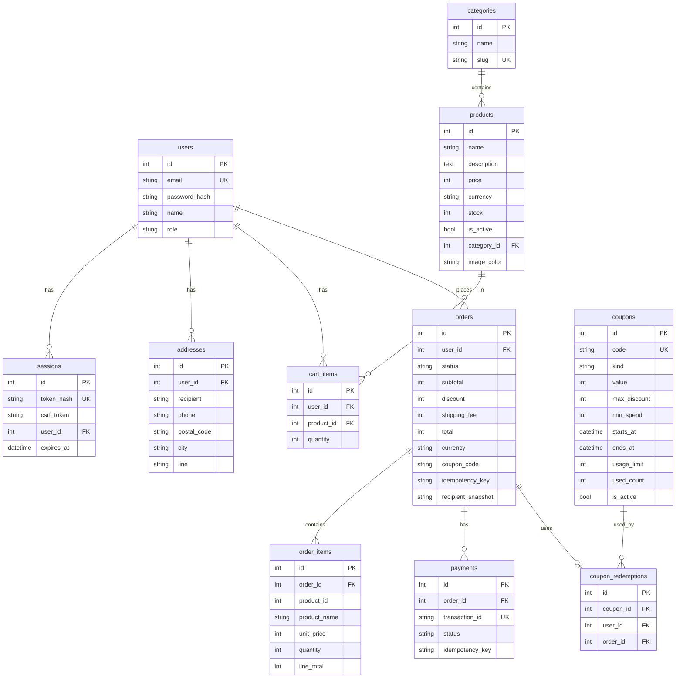

# 系統架構

```
瀏覽器
  │
  ▼
frontend（Vue 3 SPA，Vite）── 只透過 src/api/ 呼叫 ──┐
  │  npm run dev:mock：由 MSW 假後端回應，不需 backend   │ HTTP + JSON，Cookie（httpOnly）＋ X-CSRF-Token
  ▼                                                   ▼
                              backend（FastAPI，/api/v1/）
                              routers → services → repositories → models
                                                   │
                                                   ▼
                                     SQLite（開發）／PostgreSQL（正式）
```

## 後端分層
| 層 | 位置 | 職責 | 不可以做 |
|---|---|---|---|
| router | `app/routers/` | 解析 HTTP、驗證輸入（pydantic）、呼叫 service、回傳 schema | 寫商業規則 |
| service | `app/services/` | 所有商業規則：金額、庫存、狀態機、優惠券、權限判斷 | 直接處理 HTTP |
| repository | `app/repositories/` | 查詢與寫入資料庫（只用 ORM／參數化） | 商業規則 |
| model | `app/models/` | 資料表定義（dba 負責） | — |
| schema | `app/schemas/` | API 輸入輸出格式（= 契約） | 放敏感欄位 |
| core | `app/core/` | 設定、資料庫連線、安全（雜湊、Session、CSRF、限速）、錯誤格式 | — |

## 關鍵流程：建立訂單（R-06、R-11）
1. 檢查 `Idempotency-Key`：同一會員用過 → 直接回傳舊訂單
2. 讀購物車 → 由後端重新計算金額（`pricing_service`，含優惠券與運費）
3. **同一個交易**內：對每個商品執行 `UPDATE products SET stock = stock - :qty WHERE id = :id AND stock >= :qty`
   - 影響 0 列 = 庫存不足 → 整筆 rollback，回 409
   - 【為什麼】條件式更新在 SQLite 與 PostgreSQL 都是原子操作，兩人同時搶最後一件時只有一人會成功
4. 寫入訂單、明細（價格快照）、優惠券使用紀錄，清空購物車，commit

## 資料模型（ERD）


## ADR 索引
- [ADR-001 前後端分離與 API 契約產生方式](adr/ADR-001-api-contract.md)
- [ADR-002 登入狀態用 Cookie Session ＋ CSRF](adr/ADR-002-session-csrf.md)
- [ADR-003 防超賣用條件式 UPDATE](adr/ADR-003-stock.md)
- [ADR-004 模擬金流與回呼簽章](adr/ADR-004-mock-payment.md)
- [ADR-005 金額用整數元](adr/ADR-005-money.md)
